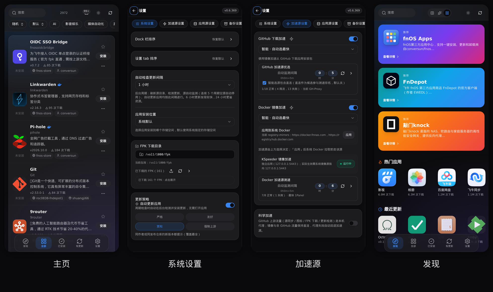
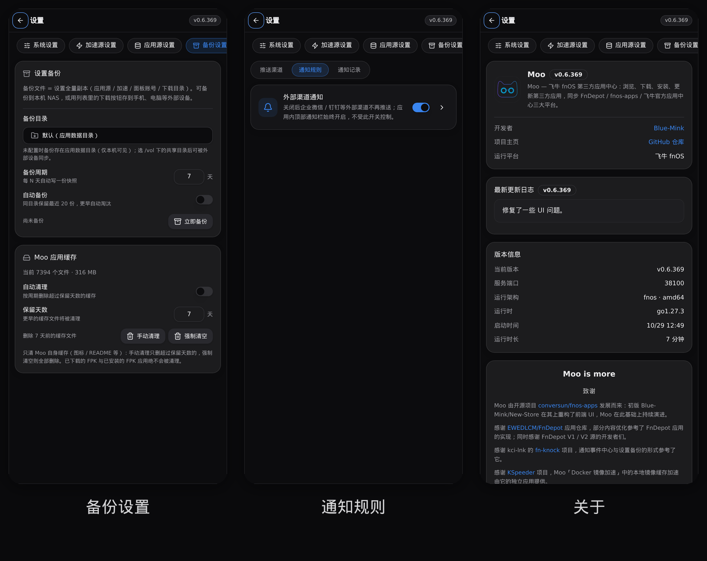
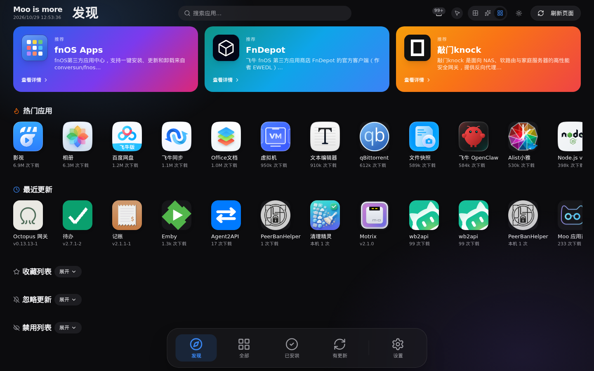
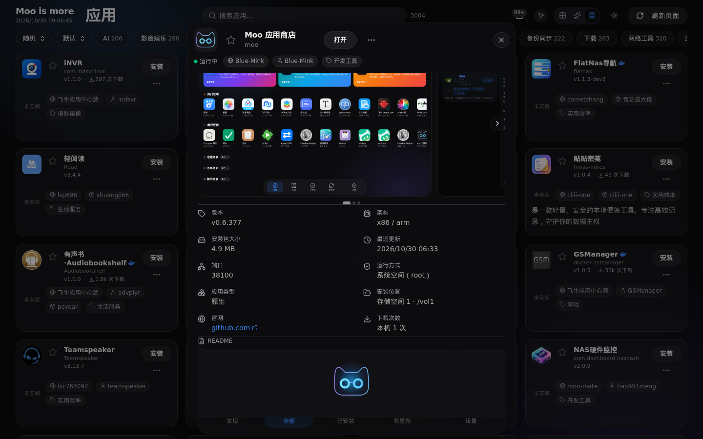
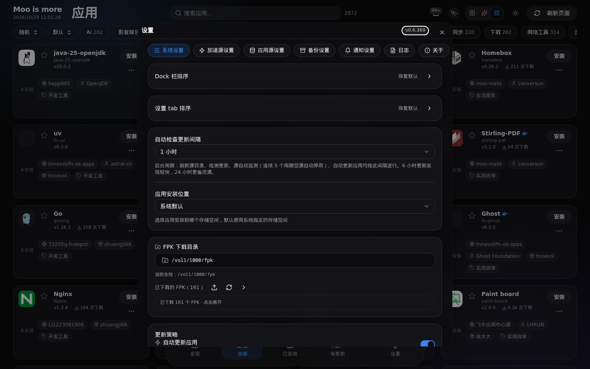

<p align="center">
  <br/>
</p>

<h1 align="center">For fnOS<br/>Moo is more</h1>

<p align="center">
  在飞牛 NAS 上装一个第三方应用中心，800+ 应用浏览 / 安装 / 更新 / 下载，通知推送开箱即用
</p>

<p align="center">
  <a href="releases/latest"></a>
  
  
  <a href="LICENSE"></a>
</p>

<p align="center">
  <a href="releases/latest">下载 FPK</a> ·
  <a href="应用介绍.md">应用介绍（图文）</a> ·
  <a href="releases">更新日志</a> ·
  <a href="https://github.com/conversun/fnos-apps">fnos-apps（上游）</a> ·
  <a href="https://github.com/Blue-Mink/moo/issues">反馈问题</a>
</p>

本仓库包含 Moo 的全部源码：Go 后端（单二进制，web embed）+ React / TypeScript 前端（Vite 构建后内嵌），发布产物为 x86_64 / arm64 双架构 FPK（0.6.303 起）。应用目录数据来自三大平台——飞牛官方应用中心、FnDepot、fnos-apps（conversun），Moo 只负责聚合、归类与推送，不修改上游数据。仓库根部的 `moo.json` 是自索引——**本仓库本身就是一个 Moo 应用源**（见下方「作为 Moo 应用源」）。

<p align="center">
  <br/>
  <b>移动端 · 主页 / 系统设置 / 加速源 / 发现（暗黑模式）</b><br/>
  App Store 风格列表 · 搜索可直接贴源链接 · 收藏与关注源
</p>

<p align="center">
  <br/>
  <b>移动端 · 设置全 tab</b><br/>
  加速源健康自动监测 · 应用源一键同步 / 清理 / 恢复 · 通知内容三档
</p>

<p align="center">
  <br/>
  <b>桌面端 · 主页</b><br/>
  14 个领域分类 chip · 应用网格 · 批量操作与拖拽排序
</p>

<table>
  <tr>
    <td width="50%" align="center"></td>
    <td width="50%" align="center"></td>
  </tr>
  <tr>
    <td align="center"><b>应用详情</b></td>
    <td align="center"><b>设置</b></td>
  </tr>
</table>

## 安装

| # | 做什么 | 说明 |
| --- | --- | --- |
| 1 | [下载 FPK](releases/latest) | 当前 `0.6.355` · x86 `2e304765f190af2fce5b105ff051da91cd6c416ae1c415471b427b505492cd17`（4.9MB） / arm `427d83be201464f133976eeb4d3cecd5d69899910cafd1610eaa399d20ce1378`（4.5MB） |
| 2 | 应用中心 → 手动安装 | 向导可选 Web 端口（默认 `38100`） |
| 3 | 面板打开 `/app/moo/` | 统一网关入口，继承面板登录 + 仅管理员 |
| 4 | （可选）配置推送渠道 | 设置 → 通知设置：企业微信 / 钉钉 / 飞书等 7 种外部渠道 |

运行要求：fnOS x86_64 / arm64。无其他依赖——后端 Go 单二进制（web embed），前端构建后内嵌，整包约 4.9 MB（x86）/ 4.5 MB（arm）。

> [!TIP]
> 装完可应用内自更新：版本号红点 + 确认框，走平台升级通道就地更新，`@appdata` 数据保留。

## 作为 Moo 应用源

仓库根部的 `moo.json` 是按 [Moo 应用源协议](docs/Moo应用源协议.md) 生成的自索引（当前收录最近 2 个版本，下载链接指向本仓库 releases，含 SHA256）。在 Moo 中添加本仓库作为源：

- 搜索框直接粘贴 `https://github.com/Blue-Mink/moo` → 自动识别为源
- 或 设置 → 应用源 → 添加源：仓库地址 / raw 直链（`…/raw/main/moo.json`）均可

这也是协议的最小可用示例源；字段规范、多版本与 `packages` 结构、版本比较规则见 [docs/Moo应用源协议.md](docs/Moo应用源协议.md)。

## Moo Mate（伴侣工具）

把第三方 GitHub 仓库里的 FPK 应用变成 Moo 可装源，免上传 GitHub：贴链接 → 自动发现 → 一键加源。

安装（任选其一）：

- **Moo 商店**：Moo 里添加源 `https://raw.githubusercontent.com/Blue-Mink/moo/main/moo.json`，搜「Moo Mate」安装
- **FnDepot 源**：添加源 `https://raw.githubusercontent.com/Blue-Mink/FnDepot/main/fnpack.json`，在列表中找到 Moo Mate
- **手动**：下载 `moo-mate_0.2.31_x86.fpk`（或 `_arm.fpk`），校验同名 `.sha256` 后在应用中心手动安装

用法三步：粘贴仓库链接 → 确认发现的应用并生成索引 → 一键加源到本机 Moo。

| 项 | 值 |
| --- | --- |
| 端口 | `38108`（仅本机回环，经面板网关访问） |
| 平台 | x86 / arm |
| 自更新 | 无（升级重装 FPK，数据保留） |
| GitHub Token | 自动复用本机 Moo 的设置，伴侣侧无需填写 |

功能与使用细节见 [cmd/moo-mate/README.md](cmd/moo-mate/README.md)。

## 为什么这样设计

| 能力 | 说明 |
| --- | --- |
| 三源同步 | 飞牛官方应用中心 · FnDepot（V1/V2）· fnos-apps；内置 20 个官方精选源（一键同步官源清单 / 清理旧清单 / 恢复），去重 / 重命名 / 拖拽排序 |
| 智能归类 | 14 个领域分类：精选表优先 → 标签映射 → 关键词兜底，官方口径对齐 |
| 通知体系 | 30+ 事件 × 7 外部渠道，内容三档 × 形式按渠道可选；应用内通知恒开、永不漏记 |
| GitHub 加速 | 多镜像测速自动优选，自更新 / FPK 下载 / 源同步全链路走加速；全挂告警 + 恢复通知 |
| 应用内自更新 | 平台升级通道就地更新，`@appdata` 数据保留；版本号红点 + 确认框 |
| 收藏与关注 | 应用收藏、关注源（新增应用推送 + 关注源报表）、忽略更新（列表可找回） |
| 搜索贴源 | 搜索框直接粘贴 GitHub / FnDepot 源地址，自动识别源并搜索其应用 |
| 深链现场恢复 | 详情/设置页（含所选 tab）写入 URL，外链返回与 F5 刷新同帧恢复现场、无跳闪（0.6.282） |
| 直链源韧性 | GitHub 系 `.json` 直链源自动展开镜像与 jsDelivr 兜底候选、兜底独立超时；同步失败通知附原因（0.6.283） |
| 网页端三视图 | 极简 / 极光 / 标准三种浏览模式：极光色板 12 组三段渐变按应用稳定取色，详情与设置对话框底板同风格，宽屏一行四卡（0.6.284→298） |
| 平台架构 | 详情页显示源提供的全部架构（x86 / arm），安装按本机架构自动选包（arm 设备选 arm 包）；发布双架构 FPK（0.6.303） |
| 分类胶囊冻结 | 桌面端分类胶囊行移入顶栏 sticky 冻结区，长列表滚动时分类常显可点（0.6.305） |
| 毛玻璃胶囊风格 | 全页按钮/徽章（安装/打开/更新/下载 FPK/保存等）统一磨砂浅蓝胶囊语言；详情/设置对话框玻璃化（半透明底+背景虚化）+45% 遮罩景深；页面环境光背景（0.6.306→308） |
| 关于页更新日志 | 设置 → 关于 tab 以卡片展示最新更新日志（0.6.311 起跟随最新版本：当前构建内嵌发布说明与源条目取版本号更大者；README 同款渲染、卡内滚动；0.6.326 起逐条分行、超过 5 条分页） |
| 应用去重三档 | 发现页分类行一键切换「全部 / 标准合并 / 只留官方」；同名应用按「已装 → 官方目录 → 本机可装」优先保留，官方源有条目即显示官方（0.6.312→313） |
| 内存与复制 | 后台刷新内存占用优化；修复应用源链接复制（0.6.314） |
| 源列表自动同步 | 设置 → 应用源一键同步内置官源清单（只增不删）/ 清理旧默认清单 / 恢复；同地址自动去重、同名自动消歧（0.6.316→318） |
| 桌面鼠标习惯 | 网页端一键切换「单击 / 双击」打开应用详情，偏好本地记忆（0.6.319） |
| 系统空间应用 | 修复系统空间（root）应用升级被「无法确定存储卷」误拦；补齐官方系统应用与应用中心安装应用的图标（0.6.320） |
| 安装向导增强 | 向导多选项字段渲染为单选组（默认项预选）、开关字段渲染为真开关，未知类型回落文本框（0.6.321） |
| 安装位置遵循设置 | FPK 安装 / 升级遵循「应用安装位置」设置（含多卷机器），安装位置下拉标注 `/volN` 挂载路径（0.6.325） |
| 加速源智能优选 | Docker 镜像组「智能」模式自动测速优选最快镜像，失败诚实报错（0.6.325） |
| 安全加固 | 源列表同步对清单中的非公网地址默认跳过（可显式放开）；镜像健康端点改为管理员权限（0.6.325） |
| 应用溯源 | 详情页显示应用的上游来源，并可「添加上游源 / 禁用 fork 源 / 禁用应用」；整仓 fork 式搬运按 fork parent 判定上游（0.6.326） |
| 强制上游策略 | 更新策略新增第四档：搬运来源的应用自动更新为上游原作者版本，与原三档并存（0.6.326） |
| 禁用应用 | 被禁用的应用从列表 / 搜索 / 推荐中隐藏，发现页「禁用列表」可一键找回（0.6.326） |
| 版本比较统一 | 修复版本号带数字修订号（如 `1.13.0-1`）检测不到更新的问题，全产品统一为唯一比较器，杜绝更新徽章误判（0.6.330） |
| 日志页单行排版 | 日志改为「时间｜级别｜详情」单行、行尾展开/收起，去右侧滚动条、内容铺满（0.6.344） |
| 下载并行安装排队 | 多任务下载并行（峰值 3）、安装严格排队（带位次提示），不再互相阻塞（0.6.347） |
| 真实运行状态 | 列表显示应用真实运行状态，停用应用置灰「启动」、点击即启动（0.6.348） |
| 官方源 OAuth 端口 | 官方源 OAuth 授权登录适配自定义面板端口，改端口无需重启；脚本同步镜像仓按内容指纹识别归上游（0.6.349→351） |
| 备份与缓存 | 配置快照一键备份 / 周期自动备份；已下载 FPK 缓存自动清理 |
| 下载中心 | aria2 高速下载 + 断点续传，任务状态全透明、可暂停 / 删除 |

## 工作原理


**一句话总结**：后端只监听回环地址，面板网关是唯一入口——继承面板登录态、仅管理员可见，不额外暴露任何公网端口。

## 通知体系

- **事件**：应用生命周期（安装 / 更新 / 卸载 / 下载 × 成功失败）、应用更新摘要、关注源变化、加速源切换 / 全挂、自身健康与资源告警、备份完成……共 30+ 类，逐条开关 + 手动触发
- **渠道**：企业微信（卡片 / 富文本表格 / 经典 markdown）· 钉钉 · 飞书 · Server酱 · PushPlus · Bark · 通用 Webhook
- **内容**：简洁（关键信息）/ 友好（关键摘要 + 折叠）/ 完整（全部信息），渠道测试即发欢迎语

## 端口与入口

| 项 | 值 | 说明 |
| --- | --- | --- |
| Web 端口 | `38100`（向导可改） | 后端仅监听回环，不直接对外 |
| 面板入口 | `/app/moo/` | 唯一入口，走面板统一网关 |

> [!NOTE]
> 入口继承面板登录 + 仅管理员，因此跨设备访问需先有面板的远程访问（如 FN Connect）。

## 仓库结构

```
cmd/          daemon 入口
cmd/moo-mate/ Moo Mate 伴侣工具（独立二进制、独立 FPK、独立发布线 mate-v*）
internal/     后端：目录构建 / 源管理 / 通知 / 加速 / 自更新 / API
frontend/     前端：React + TypeScript（Vite）
fnos/         FPK manifest 与生命周期脚本
fnos-mate/    Moo Mate 的 FPK manifest 与生命周期脚本
build-mate.sh Moo Mate 打包脚本（x86 / arm）
docs/         文档（API / 应用源协议 / 设计记录）与 README 配图
skills/       Agent Skills：使用与诊断（moo/）、构建并发布到 Moo（fpk-build-to-moo/）、应用内 AI 资料包（ai/）、第三方应用安全审核（moo-app-security-audit/）
```

## 从源码构建

```bash
./build.sh x86    # 产出 moo_<version>_x86.fpk（首次自动下载 fnpack）
./build.sh arm    # arm 版（交叉编译 + manifest platform=arm）
./build.sh all    # 双架构一次出
go test ./...     # 单元测试
```

## 文档与技能

| 资源 | 说明 | 下载 |
|---|---|---|
| [应用介绍（图文）](应用介绍.md) | 面向用户的完整图文手册：逐页功能讲解（Dock 五键 / 七 tab 设置 / 详情 / 向导）+ moo.json 源协议 + FAQ，全部截图为当前版本真实界面 | [zip](downloads/moo-doc-intro.zip) |
| [API 文档](docs/API.md) | 全部 HTTP 端点、请求/响应字段、SSE 事件、鉴权与错误码 | [zip](downloads/moo-doc-api.zip) |
| [应用源协议](docs/Moo应用源协议.md) | `moo.json` 完整规范：字段全表、14 项固定分类、多版本与 `packages`、版本比较规则、7 份带注释示例、FAQ | [zip](downloads/moo-doc-protocol.zip) |
| [仓库手册 AGENTS.md](docs/AGENTS.md) | 面向在仓库内工作的 Agent 与维护者：项目速览与目录地图、构建与提交前本地门、部署到 fnOS 的四铁律与回滚、发布顺序、脱敏硬规则、反复踩过的坑 | [zip](downloads/moo-doc-agents.zip) |
| [使用与诊断技能](skills/moo/) | Agent Skill：四平面核心模型、完整 API 镜像、安装与热替换、安全规则、排障 | [zip](downloads/moo-skill-usage.zip) |
| [构建并发布到 Moo 技能](skills/fpk-build-to-moo/) | Agent Skill：**从构建 FPK 到发布 Moo 的全流程**——构建与本地验证 → 写 `moo.json` → 放仓库（匿名可达）→ 搜索框自测 → 添加为源与详情页验收 → 版本迭代与发布脱敏 | [zip](downloads/moo-skill-build-export.zip) |
| [应用内 AI 资料包](skills/ai/) | 资料型技能：Moo 应用内 AI 助手的行为约定（纪律十条 / 排障四段式 / 去重报告版 / 静态安全扫描），按 `manifest.json` 逐文件哈希同步进应用 | [zip](downloads/moo-skill-ai.zip) |
| [应用安全审核技能](skills/moo-app-security-audit/) | Agent Skill：第三方 FPK 安全体检——病毒/木马/恶意脚本、数据破坏与勒索、权限面、弱默认口令、攻击面；三层分析（元数据 → 源码 → 解包二进制），附 `fpk_audit.py` | [zip](downloads/moo-skill-security-audit.zip) |
| [Moo 自身安全审核报告（v0.6.329）](SECURITY-AUDIT-0.6.329.md) | 用上表的安全审核技能对 **Moo 自身**做三层审核（元数据 → 源码 → 解包二进制）：八维安全分 68 🟡、M1–M6 恶意面全未命中、minisign + sha256 双验签通过、发现清单（1 中 2 低 3 信息）与完整复现步骤 | — |
| [发布到 FnDepot 技能](https://github.com/Blue-Mink/fpk-build-to-fndepot-skill) | Agent Skill：FnDepot V2 协议与上架流程 | [main.zip](https://github.com/Blue-Mink/fpk-build-to-fndepot-skill/archive/refs/heads/main.zip) |
| [FPK 构建技能](https://github.com/Blue-Mink/fn-fpk-builder-skill) | Agent Skill：FPK 打包 / 校验 / 发布 / SSH 部署与排障 | [main.zip](https://github.com/Blue-Mink/fn-fpk-builder-skill/archive/refs/heads/main.zip) |

> `fpk-build-to-fndepot` / `fn-fpk-builder` 为独立仓库的技能，克隆到工作区的 `skills/` 目录即可被 Agent 识别（「下载」列为 GitHub 自动归档）；
> 其余四项随本仓库分发（见 [`skills/`](skills/)），「下载」列为对应资源的单独压缩包（保持原目录结构）。

📦 **[下载「文档与技能」压缩包](downloads/moo-docs-skills.zip)**（约 200 KB）——打包 `应用介绍.md`、`docs/` 下全部 Markdown（API / 应用源协议 / AGENTS / 设计记录）与四个随仓库分发的 Agent Skill（`skills/moo`、`skills/fpk-build-to-moo`、`skills/ai`、`skills/moo-app-security-audit`），解压后把 `skills/` 下的目录放进工作区即可被 Agent 识别；配图不打包，见仓库 [`docs/`](docs/)。

## 📄 许可证

[MIT License](LICENSE) · © 2026 Blue-Mink

---

## 🙏 致谢

- [conversun/fnos-apps](https://github.com/conversun/fnos-apps) —— 第三方应用目录数据源，Moo 由其发展而来
- [FnDepot](https://github.com/EWEDLCM/FnDepot) 及其源开发者们 —— 第三方应用源生态
- [fn-knock](https://github.com/kci-lnk/fn-knock-turborepo) —— 通知事件中心与设置备份的形式参考、发布审计（CI 门禁）借鉴
- [飞牛 fnOS](https://www.fnnas.com/) —— 友好的 NAS 操作系统
- AI 模型 —— 开发全程协作伙伴

---

<div align="center">

**如果觉得好用，顺手点个 ⭐ Star 支持一下！**

Made with ❤️ by [Blue-Mink](https://github.com/Blue-Mink)

</div>
